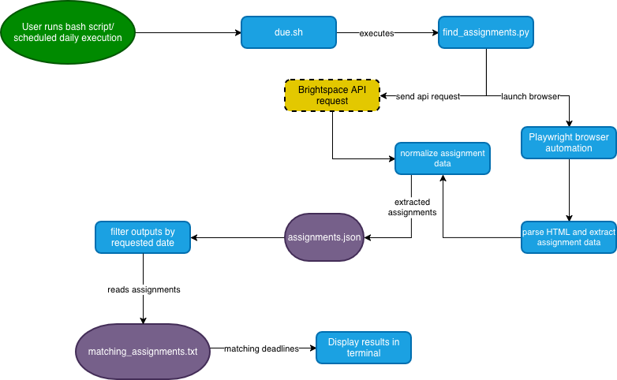

# PurdueDue
Command-line tool that finds and outputs assignment deadlines across different platforms

## The Problem

4/5 of my classes have homework submission on unique websites, and none of them appear on the Brightspace assignment calendar. I imagine, then, that others find the same issues with organization as I do since you have to go through many different authentication pages as you loop through all the pages that have your assignments.

## How It Works

1. The user executes the Bash script, either manually or through a scheduled task.
2. The Bash script launches the Python program.
3. Python retrieves assignment information using the Brightspace API and Playwright browser automation.
4. Retrieved information is parsed and converted into a normalize format.
5. Assignment records are saved to a JSON file.
6. The program filters assignments by due date and displays matching results.

If the Brightspace API is inaccessible, browser automation may be used as an alternative.

### System Diagram

## Tech Stack

- **Languages:** Bash, Python
- **Libraries:** Playwright, datetime, json, BeautifulSoup (may be cut once development begins if not needed)
- **External tools:** cron, Brightspace API

## Setup

*Installation and use instructions will be updated as development progresses.*

## Usage

*cmd line interfrace is under development.*

The intended usage is to run the program to retreive assignments due today, with additional date selection options planned for later versions.

## Roadmap

- [ ] Implement core bash and Python.
- [ ] Retrieve assignment deadlines from Brightspace.
- [ ] Add support for data retrieval from additional platforms.
- [ ] Assignment data normalization and json storage.
- [ ] Create display for assignments due today.
- [ ] Support for custom dates and ranges.
- [ ] Add desktop notifications.
- [ ] Export assignment deadlines to a calendar.

### Eisenhower Matrix

## Author

Julian Matteoni, https://github.com/goodmorning-captain/
